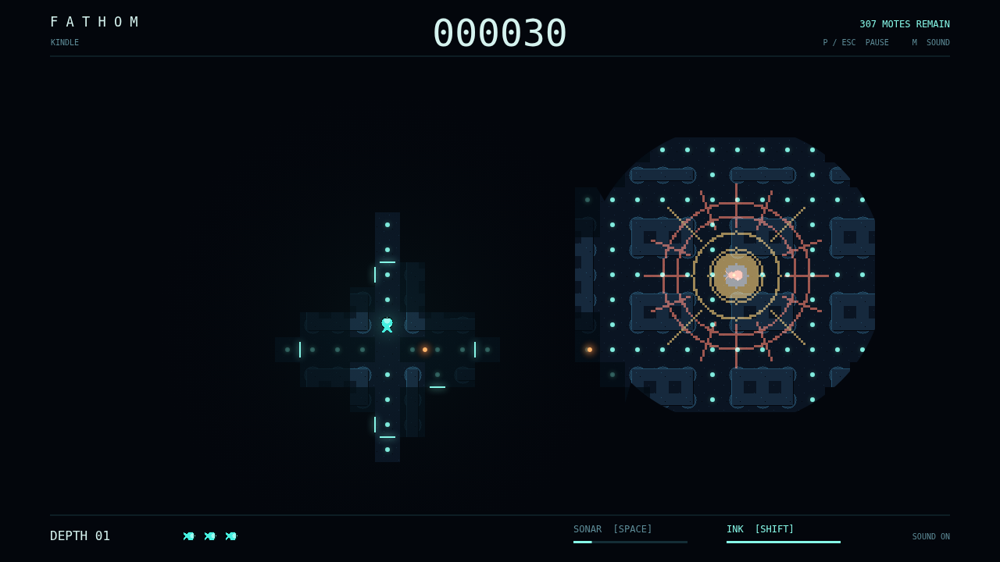

# Fathom

A little light. A long way down. You are a glowing forager in a flooded maze, grazing tiny plankton while something moves beyond the edge of sight. Clear every mote to descend another depth into the abyss.

Eating makes your light grow. Nearby passages come into focus, and the circle around you opens wider onto ground you remember. Stop feeding and that safety shrinks. Sonar spills around corners, showing routes your light cannot reach — but the deep can hear it too.

An amber glimmer might be a harmless drifter, or a Lanternjaw wearing its disguise. Gloamfin has no eyes; it listens for your pulse and answers with one of its own. Flarefish gives you a moment of warning before its bloom tears open the darkness. Each asks for a different escape, and ink only blinds the hunters that see.

Thread a corner, drop a cloud, and keep swimming. A lost life leaves your progress behind, but each new depth brings more hunters and a shorter sonar reach. How far can you carry your light?

